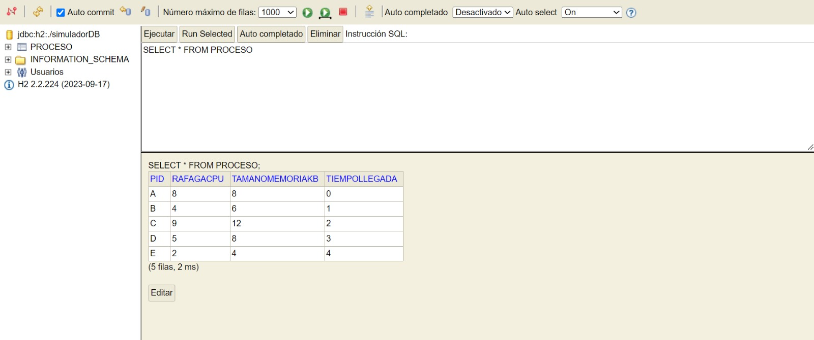

<h1 align="center">🖥️ Simulador de Planificación de CPU y Gestión de Memoria</h1>

<p align="center">
  Simulador interactivo y multihilo de conceptos fundamentales de Sistemas Operativos, desarrollado en Java.
</p>

<p align="center">
  
</p>

<p align="center">
  
  
  
  
  
</p>

---

<a id="contenido"></a>
## 📑 Contenido

- [👀 Vista general](#vista-general)
- [🖼️ Capturas de pantalla](#capturas-de-pantalla)
- [🚀 Características principales](#caracteristicas-principales)
  - [Planificación de CPU](#planificacion-de-cpu)
  - [Gestión de memoria y MMU](#gestion-de-memoria-y-mmu)
  - [Concurrencia y sincronización](#concurrencia-y-sincronizacion)
  - [Persistencia con JPA, Hibernate y H2](#persistencia-con-jpa-hibernate-y-h2)
  - [Interfaz gráfica y reportes](#interfaz-grafica-y-reportes)
- [🛠️ Stack tecnológico](#stack-tecnologico)
- [🏗️ Organización del proyecto](#organizacion-del-proyecto)
- [⚙️ Requisitos e instalación](#requisitos-e-instalacion)
- [▶️ Ejecución](#ejecucion)
- [🗄️ Consola web de H2](#consola-web-de-h2)
- [📊 Métricas de simulación](#metricas-de-simulacion)
- [📄 Licencia](#licencia)

---

<a id="vista-general"></a>
## 👀 Vista general

El proyecto permite experimentar con la **planificación de procesos a corto plazo**, la **paginación de memoria**, la **traducción de direcciones mediante una MMU** y distintos mecanismos de **concurrencia y sincronización**.

La aplicación combina una interfaz gráfica de escritorio desarrollada con Java Swing, un motor de simulación por *ticks*, persistencia local mediante JPA/Hibernate y una base de datos H2. También permite comparar los resultados de los algoritmos de planificación y exportar reportes en PDF.

Su propósito es representar de manera visual y controlada cómo las decisiones de planificación y administración de memoria afectan la ejecución de un conjunto de procesos.

<a id="capturas-de-pantalla"></a>
## 🖼️ Capturas de pantalla

<p align="center">
  
  
</p>

<p align="center">
  
</p>

---

<a id="caracteristicas-principales"></a>
## 🚀 Características principales

<a id="planificacion-de-cpu"></a>
### 1. Planificación de CPU

El módulo de planificación utiliza el patrón **Strategy** mediante la interfaz `PlanificadorStrategy`, lo que permite seleccionar distintos algoritmos sin modificar el motor principal de simulación.

| Algoritmo | Tipo | Criterio de selección |
|---|---|---|
| **FCFS** (*First-Come, First-Served*) | No apropiativo | Ejecuta los procesos en orden de llegada. |
| **SJF** (*Shortest Job First*) | No apropiativo | Selecciona el proceso listo con la ráfaga de CPU más corta. |
| **SRTF** (*Shortest Remaining Time First*) | Apropiativo | Selecciona el proceso con menor tiempo de CPU restante y puede desalojar al que está ejecutándose. |
| **Round Robin (RR)** | Apropiativo | Distribuye la CPU mediante una cola circular y un *quantum* configurable. |

**Comparación completa:** la interfaz permite ejecutar los cuatro algoritmos de manera secuencial sobre el conjunto de procesos recuperado de la base de datos, utilizando los parámetros de memoria y reemplazo seleccionados.

<a id="gestion-de-memoria-y-mmu"></a>
### 2. Gestión de memoria y MMU

El módulo `GestorMemoria` representa la administración de memoria mediante paginación y marcos físicos de RAM.

- **Paginación:** calcula la cantidad de páginas necesarias para cada proceso a partir de su tamaño y del tamaño de página configurado.
- **Marcos de RAM:** administra los marcos físicos disponibles y registra qué proceso y página ocupa cada uno.
- **MMU:** traduce direcciones lógicas a direcciones físicas utilizando el número de página, el desplazamiento y el marco asignado. La dirección física se presenta en hexadecimal.
- **Fallos de página (*Page Faults*):** detecta los accesos a páginas que no se encuentran presentes en RAM.
- **Reemplazo de páginas:** permite seleccionar entre FIFO y LRU cuando se necesita liberar un marco ocupado.
- **Fragmentación interna:** calcula el espacio asignado que no aprovecha el proceso por efecto del tamaño fijo de las páginas.

| Algoritmo | Descripción |
|---|---|
| **FIFO** (*First-In, First-Out*) | Selecciona para reemplazo la página que lleva más tiempo cargada en memoria. |
| **LRU** (*Least Recently Used*) | Selecciona la página cuyo último acceso registrado es el más antiguo. |

> **Alcance de la simulación:** las páginas que no están presentes en RAM se representan como páginas no residentes en memoria secundaria (*Swap/Disco*). El proyecto modela su presencia, los fallos y los reemplazos, pero no implementa un sistema de intercambio real ni la transferencia de contenido de páginas a un dispositivo físico.

<a id="concurrencia-y-sincronizacion"></a>
### 3. Concurrencia y sincronización

El simulador incorpora hilos y semáforos para representar la coordinación entre la llegada de procesos, el motor de simulación y el acceso a recursos compartidos.

#### 🔄 Productor-consumidor

- `HiloProductor`: inyecta los procesos en el sistema respetando sus tiempos de llegada.
- `BufferProcesos`: mantiene una cola compartida con capacidad limitada.
- **Semáforos contadores:** `vacios` y `llenos` coordinan la disponibilidad de espacios y elementos.
- **Mutex:** protege las operaciones de acceso a la cola compartida.

El productor y el motor utilizan una escala temporal de simulación en la que **un tick equivale aproximadamente a 500 ms**.

#### 🖨️ Recurso compartido: impresora virtual

La clase `ImpresoraVirtual` representa un recurso de entrada/salida protegido mediante un semáforo binario (`Semaphore`). El motor realiza intentos de acceso durante la ejecución para ilustrar la sección crítica y la exclusión mutua.

<a id="persistencia-con-jpa-hibernate-y-h2"></a>
### 4. Persistencia con JPA, Hibernate y H2

La persistencia separa los datos que se almacenan de los atributos temporales utilizados durante cada simulación.

- **JPA 2.2:** define el mapeo objeto-relacional de la entidad `Proceso`.
- **Hibernate 5.6.15.Final:** implementa la capa de persistencia ORM.
- **H2 2.2.224:** proporciona una base de datos relacional embebida, almacenada localmente y sin necesidad de instalar un servidor externo.
- **Patrón DAO:** `IProcesoDao` define las operaciones de acceso a datos y `ProcesoDaoImpl` las implementa mediante `EntityManager` y consultas JPQL.
- **Atributos persistentes y transitorios:** los datos de identificación y parámetros básicos del proceso se almacenan; el estado de ejecución, la tabla de páginas y las métricas temporales se reconstruyen al recuperar los procesos.

Si la tabla de procesos está vacía al iniciar la aplicación, `Main` carga un conjunto inicial de cinco procesos de ejemplo.

<a id="interfaz-grafica-y-reportes"></a>
### 5. Interfaz gráfica y reportes

#### 🖥️ Interfaz de escritorio

La aplicación utiliza **Java Swing** y una organización **Modelo-Vista-Controlador (MVC)**.

Desde la ventana principal se puede:

- Seleccionar FCFS, SJF, SRTF, Round Robin o la comparación completa.
- Configurar el tamaño de RAM y el tamaño de página.
- Definir el *quantum* de Round Robin.
- Seleccionar el algoritmo de reemplazo FIFO o LRU.
- Agregar procesos a la base de datos.
- Iniciar simulaciones y observar la salida del motor en una consola integrada.

La ejecución de las simulaciones se inicia en un hilo de trabajo separado para evitar bloquear la interfaz. La salida de consola se presenta en el área de texto de Swing mediante el Event Dispatch Thread (EDT).

#### 📄 Exportación de reportes PDF

Al finalizar cada simulación, la aplicación permite solicitar la generación de un reporte PDF. Para ello utiliza:

- **iText 5.5.13.3:** composición y generación del documento PDF.
- **JFreeChart 1.5.3:** generación del gráfico de barras de métricas.

Los reportes se guardan en `Reportes Simulacion/` e incluyen información por proceso, promedios, el historial del diagrama de Gantt y un gráfico comparativo de tiempos de retorno y espera.

---

<a id="stack-tecnologico"></a>
## 🛠️ Stack tecnológico

| Componente | Tecnología | Uso |
|---|---|---|
| Lenguaje | Java 25 | Implementación del simulador. |
| Construcción | Apache Maven | Gestión de dependencias y compilación. |
| Interfaz gráfica | Java Swing | Ventana de configuración y consola integrada. |
| Arquitectura | MVC | Separación entre modelo, vista y controlador. |
| Planificación | Patrón Strategy | Intercambio de algoritmos de planificación. |
| Concurrencia | `Thread` y `Semaphore` | Productor-consumidor, mutex y ejecución en segundo plano. |
| Persistencia | JPA 2.2 y Hibernate 5.6.15.Final | Mapeo objeto-relacional. |
| Base de datos | H2 2.2.224 | Almacenamiento relacional embebido. |
| Gráficos | JFreeChart 1.5.3 | Gráficos estadísticos para los reportes. |
| PDF | iText 5.5.13.3 | Generación de reportes. |

Las versiones indicadas corresponden a las propiedades y dependencias declaradas en `SimuladorSO/pom.xml`.

---

<a id="organizacion-del-proyecto"></a>
## 🏗️ Organización del proyecto

El repositorio contiene el README y los recursos gráficos en la raíz. El proyecto Maven se encuentra dentro de `SimuladorSO/`.

```text
Simulador-Planificacion-CPU-Memoria/
├── .gitignore
├── README.md
├── Screenshots/
│   ├── H2_Consola.jpeg
│   ├── Ventana Principal 1.jpeg
│   └── Ventana Principal 2.jpeg
│
└── SimuladorSO/
    ├── pom.xml
    └── src/
        └── main/
            ├── java/
            │   └── simulador/
            │       ├── Main.java
            │       ├── concurrencia/
            │       │   ├── BufferProcesos.java
            │       │   ├── HiloProductor.java
            │       │   └── ImpresoraVirtual.java
            │       ├── controlador/
            │       │   └── ControladorSimulador.java
            │       ├── dao/
            │       │   ├── IProcesoDao.java
            │       │   └── ProcesoDaoImpl.java
            │       ├── memoria/
            │       │   └── GestorMemoria.java
            │       ├── modelo/
            │       │   ├── EntradaTablaPagina.java
            │       │   ├── EstadoProceso.java
            │       │   ├── MarcoRAM.java
            │       │   └── Proceso.java
            │       ├── motor/
            │       │   └── MotorSimulacion.java
            │       ├── planificador/
            │       │   ├── PlanificadorFCFS.java
            │       │   ├── PlanificadorRoundRobin.java
            │       │   ├── PlanificadorSJF.java
            │       │   ├── PlanificadorSRTF.java
            │       │   └── PlanificadorStrategy.java
            │       ├── reportes/
            │       │   └── GeneradorReporte.java
            │       └── vista/
            │           └── VentanaPrincipal.java
            │
            └── resources/
                └── META-INF/
                    └── persistence.xml
```

---

<a id="requisitos-e-instalacion"></a>
## ⚙️ Requisitos e instalación

### Requisitos previos

- **Java JDK 25:** el `pom.xml` configura `maven.compiler.release` en `25`.
- **Apache Maven 3.6.3 o posterior:** necesario para compilar y para ejecutar el objetivo de `exec-maven-plugin` indicado más abajo.
- **Git:** para clonar el repositorio.

Podés comprobar las herramientas instaladas con:

```bash
java -version
mvn -version
git --version
```

### 1. Clonar el repositorio

```bash
git clone https://github.com/TomasMoroz04/Simulador-Planificacion-CPU-Memoria.git
cd Simulador-Planificacion-CPU-Memoria/SimuladorSO
```

### 2. Compilar el proyecto

Ejecutá Maven desde el directorio `SimuladorSO`, donde se encuentra el `pom.xml`:

```bash
mvn clean package
```

---

<a id="ejecucion"></a>
## ▶️ Ejecución

Desde el mismo directorio `SimuladorSO`, ejecutá la clase principal mediante el objetivo `java` de Exec Maven Plugin:

```bash
mvn org.codehaus.mojo:exec-maven-plugin:3.6.4:java -Dexec.mainClass=simulador.Main
```

El `pom.xml` declara la propiedad `exec.mainClass` con el valor `simulador.Main`, pero no declara el plugin dentro de `<build><plugins>`. Por eso, el comando utiliza las coordenadas completas del plugin y especifica su versión.

Al iniciar, la aplicación:

1. Intenta iniciar la consola web de H2 en el puerto `8082`.
2. Inicializa el DAO y la conexión con la base de datos.
3. Carga cinco procesos de ejemplo si la tabla está vacía.
4. Abre la ventana principal de Swing.

---

<a id="consola-web-de-h2"></a>
## 🗄️ Consola web de H2

Mientras la aplicación está ejecutándose, podés acceder a la consola web de H2 desde el navegador:

**[http://localhost:8082](http://localhost:8082)**

Utilizá los siguientes parámetros de conexión, definidos en `src/main/resources/META-INF/persistence.xml`:

| Parámetro | Valor |
|---|---|
| **Driver Class** | `org.h2.Driver` |
| **JDBC URL** | `jdbc:h2:./simuladorDB;DB_CLOSE_DELAY=-1` |
| **User Name** | `sa` |
| **Password** | Vacía |

La ruta `./simuladorDB` es relativa al directorio de trabajo desde el que se inicia la aplicación. Por eso, los comandos de ejecución anteriores se realizan desde `SimuladorSO/`.

Una vez conectada la consola, podés consultar los procesos almacenados con:

```sql
SELECT * FROM PROCESO;
```

---

<a id="metricas-de-simulacion"></a>
## 📊 Métricas de simulación

Al finalizar una ejecución, el motor presenta una tabla con datos individuales y promedios del conjunto de procesos.

### ⏱️ Tiempo de retorno

Tiempo transcurrido desde la llegada del proceso hasta su finalización:

$$
T_{retorno} = T_{finalizacion} - T_{llegada}
$$

### ⏳ Tiempo de espera

Para el modelo de una única ráfaga de CPU utilizado por este simulador, se calcula como:

$$
T_{espera} = T_{retorno} - T_{CPU}
$$

### 🧠 Fragmentación interna

Espacio asignado mediante páginas que no es utilizado por el proceso:

$$
F_{interna} = (N_{paginas} \times T_{pagina}) - T_{proceso}
$$

### 📈 Indicadores adicionales

- **Fallos de página:** cantidad de accesos a páginas no presentes en RAM.
- **Reemplazos de páginas:** cantidad de sustituciones de marcos físicos mediante FIFO o LRU.
- **Diagrama de Gantt:** secuencia temporal que muestra qué proceso utilizó la CPU en cada tick, incluyendo períodos de inactividad.
- **Promedios del sistema:** tiempo medio de retorno y tiempo medio de espera.

---

<a id="licencia"></a>
## 📄 Licencia

El repositorio no contiene actualmente un archivo `LICENSE` ni declara una licencia en sus metadatos de GitHub. Por lo tanto, este README no atribuye una licencia de uso, modificación o redistribución al proyecto.

---

<p align="center">
  <strong>Desarrollado en Java ☕ | Sistemas Operativos | Planificación de CPU y Gestión de Memoria</strong>
</p>
